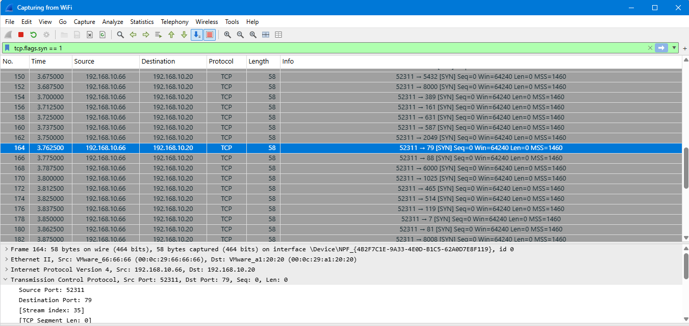
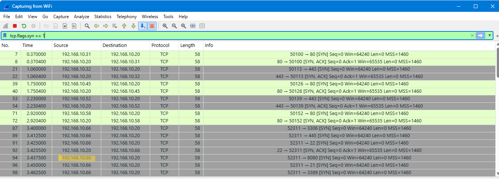
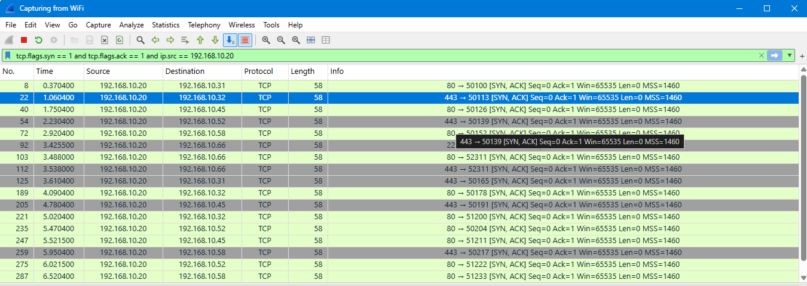
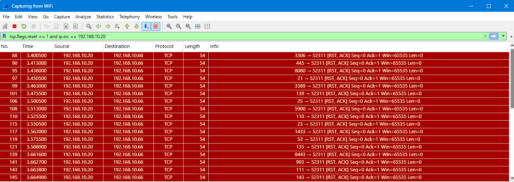
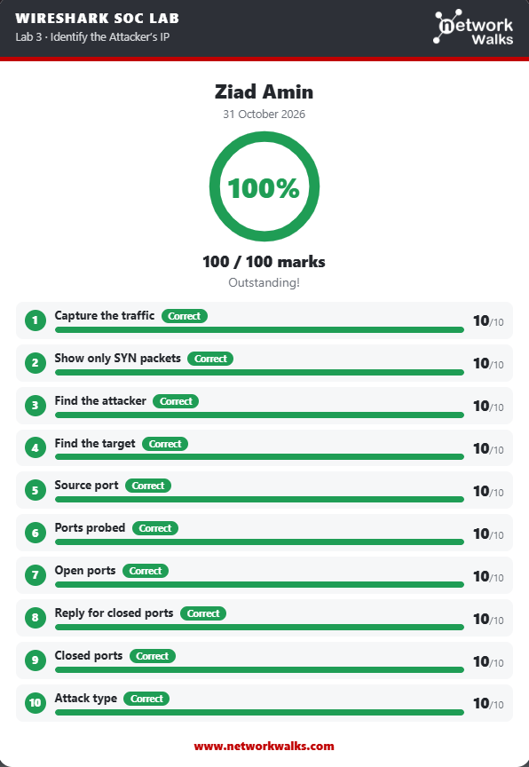

# 🕵️‍♂️ SOC Analyst Training: Wireshark Traffic Analysis Lab

## 📖 Overview
This repository contains my documentation and findings for the **Wireshark Project Module (Extra)** completed as part of the Networkwalks Cybersecurity Internship (Batch B084). 

The objective of this project was to act as a SOC Analyst, investigating network traffic to identify a port scan attack, map open services, and document the findings. 

## 🛠️ Tools Used
*   **Networkwalks SOC Lab Portal:** Browser-based interactive labs.
*   **Wireshark:** For packet analysis, filtering, and deep packet inspection.

## 🚀 Lab: Identify the Attacker's IP

### Scenario
A staff member reported unusual traffic to the company's web server. The goal was to find out what type of attack this was and what the attacker's IP address is.

### Methodology & Findings

**1. Filtering for Connection Attempts**
To find the attacker, I filtered for TCP connections starting with the SYN flag. 
*   **Filter used:** `tcp.flags.syn == 1`
*   **Result:** This revealed multiple connection attempts, but one IP address was sending them rapidly to different ports.
 

**2. Identifying the Attacker & Source Port**
By inspecting the packets, I identified the attacker's IP and noticed they were using the exact same source port for every attempt.
*   **Attacker IP:** `192.168.10.66`
*   **Source Port:** `52311`
 

**3. Mapping Open vs. Closed Ports**
The attacker was scanning a list of 40 common ports. To see which ones were actually open, I filtered for server responses that had both the SYN and ACK flags set.
*   **Filter used:** `tcp.flags.syn == 1 and tcp.flags.ack == 1 and ip.src == 192.168.10.20`
*   **Open Ports Discovered:** `22 (SSH)`, `80 (HTTP)`, and `443 (HTTPS)`.
 

**4. Confirming Closed Ports**
To confirm the rest of the scan, I filtered for server responses containing the RST (Reset) flag, which indicates the port is closed.
*   **Filter used:** `tcp.flags.reset == 1 and ip.src == 192.168.10.20`
*   **Closed Ports:** 37 out of 40.

## 🏆 Results
Successfully completed all 10 tasks and achieved a **100% score (100/100 marks)**.

---
*Created as part of the Networkwalks Cybersecurity Internship (Batch B084).*
*Special thanks to Sir Waqas Karim (CCIE) and the NETWORKWALKS team.*
